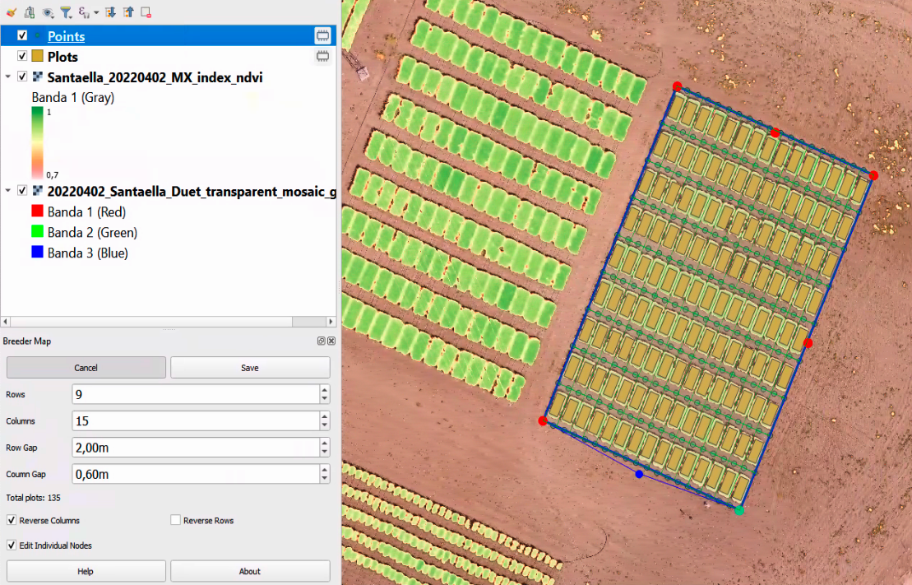
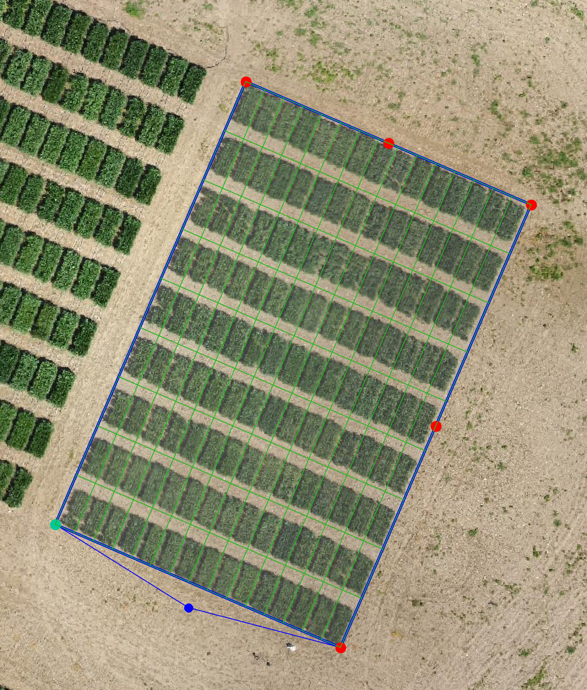
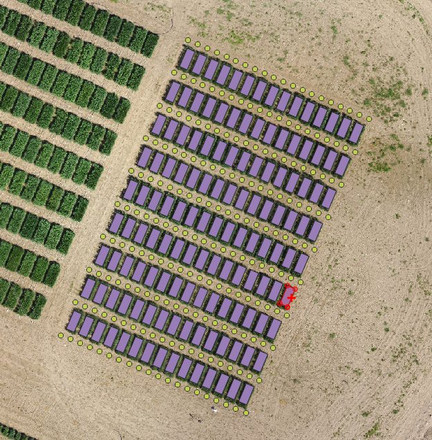
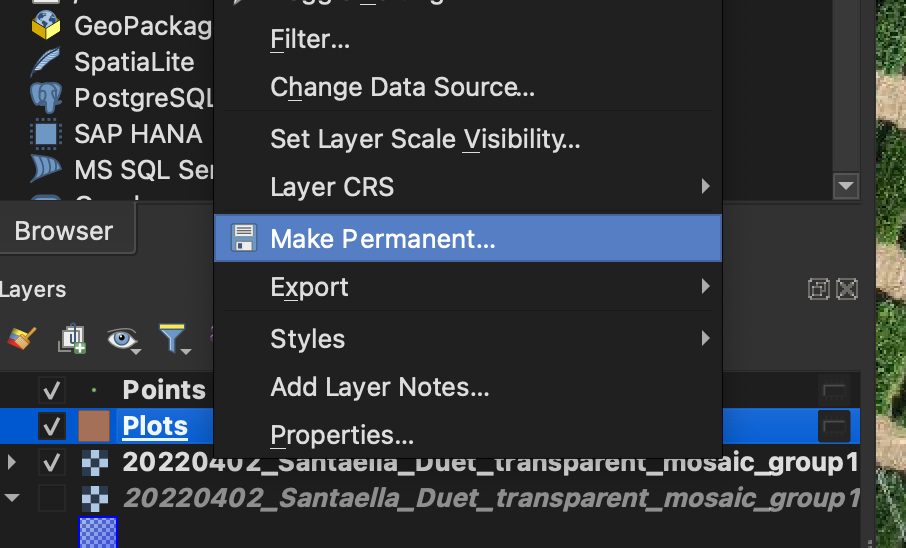

# Breeder Map

This plugin allows the creation of a grid of polygons that define the
plots in the breeding trial. These polygons will be labelled
automatically with auto-increments for columns and rows. The user
must specify the number of columns (each tractor track) and rows
(plots in the tractor's direction when sowing) and the
gaps between plots. The grid placement is interactive, and it is
possible to edit the vertex independently for non-regular shapes. It
is also essential to define the starting plot for correct automatic
numbering.

The plugin generates two temporary layers. One polygon layer and a
point layer. The polygon layer contains the plot and has three
attributes: column, row and num. The num attribute is a
unique identifier calculated as “column” * 1000 + “row”. The point
layer contains points extracted at the plot gaps that can be used to
calculate the ground height when calculating plot height from a DEM.

## Instalation

You need QGIS version > 3.0. In the Plugin menu (Manage and Install Plugins...), search for "Breeder" and select it:

## Running Breeder Map

Load your raster data. Ideally, you want to use the highest-resolution data so you can clearly see the experiment's layout.

Click on the Breeder Map icon in your toolbox to show the panel with the Breeder Map tool:

This will show the parameters for the row and columns, spacing and so on:

Define the number of Rows and Columns and gaps and click on "Start"

### Row / Column convention

In Breeder Map, Columns are each line in the direction of sowing, while Rows are each plot along the Columns. 

This will show a grid on top of your map:

There are two modes for adjusting the plots:
* Stretching the width and length of the grid layout
* Editing the four individual corners

Note that the green dot marks the 1-1 plot. You can adjust it by clicking on Reverse Rows or Reverse Columns. 

Once your layout is aligned with the plots, click Save and the plugin will create two new temporary layers.
One layer contains the rectangles for each plot and the second layer are points created in the alleys for terrain extraction. 
These points can be used to extract the bare ground height from a digital surface model, allowing the extraction of canopy height. 

Remember to make the layers permanent; if not, they will be lost when closing QGIS.

## Funding and citation

This plugin has been developed under the project CERESTRES: Advanced phenomics for screening physiological traits in cereals aimed at quantification and early detection of leaf fungal diseases and of water stress. Project PID2020-118650RR-C33 funded by MICIU/AEI/10.13039/501100011033.

